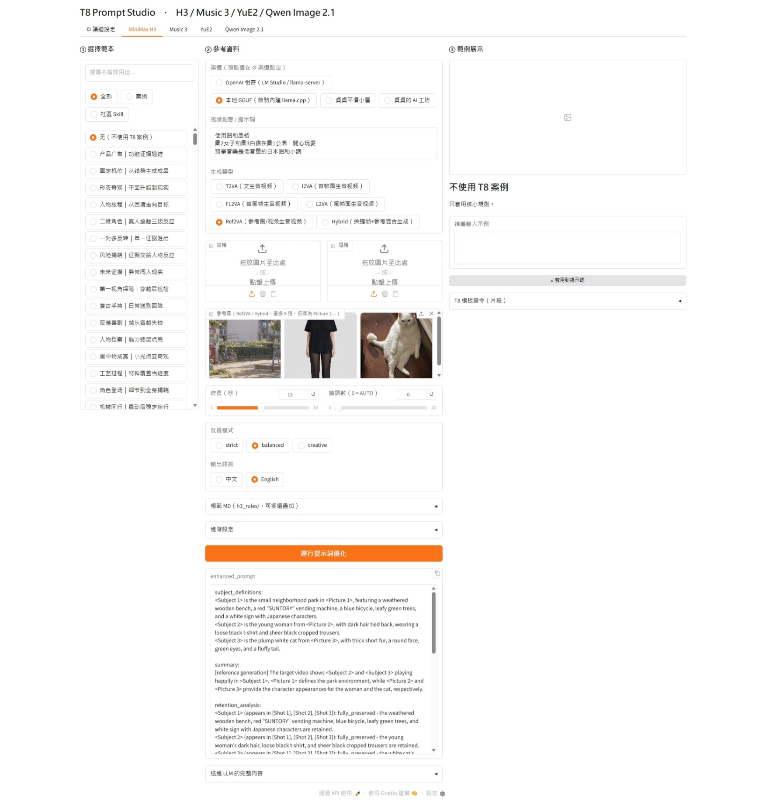

# T8 Prompt Studio

讓 [comfyui-minimax-h3-prompt-enhancer-T8](https://github.com/T8mars/comfyui-minimax-h3-prompt-enhancer-T8) 節點**脫離 ComfyUI 單獨運行**的 Gradio WebUI。

不用開 ComfyUI、不用排 ComfyUI 的單線佇列，四個提示詞增強器各一個分頁，可以同時執行。可以接 LM Studio、llama-server 等 OpenAI 相容 API，也可以用本地 llama.cpp 跑 GGUF。

| 分頁 | 用途 | 輸出 |
|---|---|---|
| ⚙ 渠道設定 | API、本地 llama.cpp、模型與並行數 | — |
| MiniMax H3 | MiniMax-H3 視頻提示詞（T2VA / I2VA / FL2VA / L2VA / Ref2VA / Hybrid） | enhanced_prompt |
| Music 3 | MiniMax Music 3 歌詞與音樂描述 | lyrics、music_caption、payload JSON、報告 |
| YuE2 | YuE2 風格、歌詞與 ABC 樂譜 | style、lyrics、abc、請求 JSON、報告 |
| Qwen Image 2.1 | 文生圖，或 1–10 張圖的圖像編輯提示詞 | rewritten_prompt、wh_ratio、請求 JSON、報告 |

> [!IMPORTANT]
> 本專案只是 T8 節點的**外部啟動介面**，不包含、也不散布節點的任何程式碼、模板庫或預覽圖。
> T8 節點的版權屬於 T8mars（All rights reserved），請從[官方 repo](https://github.com/T8mars/comfyui-minimax-h3-prompt-enhancer-T8) 自行安裝並遵守其授權條款。
> 本專案與 T8mars、MiniMax、ByteDance、Gradio 皆無隸屬關係。

---

## 實際範例

用 T8 Prompt Studio 產生 MiniMax H3 提示詞，再丟進 ComfyUI 的 H3 工作流生成影片。

### 介面



| 設定 | 值 |
|---|---|
| 渠道 | 本地 GGUF（節點內建 llama.cpp） |
| T8 模板 | 无（不使用 T8 案例） |
| 規範 MD | 昭和後期電影感（模板層） |
| 生成類型 | Ref2VA（參考圖生音視頻） |
| 參考圖 | Picture 1 公園、Picture 2 女子、Picture 3 白貓 |
| 時長 / 鏡頭數 | 15 秒 / AUTO |
| 改寫模式 / 輸出語言 | balanced / English |

輸入的提示詞只有三行：

```text
使用昭和風格
圖2女子和圖3白貓在圖1公園，開心玩耍
背景音樂是低音量的日本昭和小調
```

<details>
<summary><b>展開：WebUI 產生的完整 H3 提示詞</b></summary>

```text
subject_definitions:
<Subject 1> is the small neighborhood park in <Picture 1>, featuring a weathered wooden bench, a red "SUNTORY" vending machine, a blue bicycle, leafy green trees, and a white sign with Japanese characters.
<Subject 2> is the young woman from <Picture 2>, with dark hair tied back, wearing a loose black t-shirt and sheer black cropped trousers.
<Subject 3> is the plump white cat from <Picture 3>, with thick short fur, a round face, green eyes, and a fluffy tail.

summary:
[reference generation] The target video shows <Subject 2> and <Subject 3> playing happily in <Subject 1>. <Picture 1> defines the park environment, while <Picture 2> and <Picture 3> provide the character appearances for the woman and the cat, respectively.

retention_analysis:
<Subject 1> (appears in [Shot 1], [Shot 2], [Shot 3]): fully_preserved - the weathered wooden bench, red "SUNTORY" vending machine, blue bicycle, leafy green trees, and white sign with Japanese characters are retained.
<Subject 2> (appears in [Shot 1], [Shot 2], [Shot 3]): fully_preserved - the young woman's dark hair, loose black t-shirt, and sheer black cropped trousers are retained.
<Subject 3> (appears in [Shot 1], [Shot 2], [Shot 3]): fully_preserved - the white cat's thick short fur, round face, green eyes, and fluffy tail are retained.

detailed_description:
Live-action late-Showa Japanese 35mm film print, a small neighborhood park, dappled afternoon sunlight, milky halation, gray-blue shade, visible film grain, warm-yellow skin, faded dyes, soft old-lens haze that is not blur, subtle gate weave. No rim light.
<Picture 1> is the environment reference for <Subject 1>, not a first-frame lock.
<Picture 2> is the face and hair reference for <Subject 2>, not a first-frame lock.
<Picture 3> is the body and fur reference for <Subject 3>, not a frame anchor.
[Shot 1] The scene opens with a wide shot of <Subject 1>. <Subject 2> sits on the weathered wooden bench, her bare feet resting on the gravel, while <Subject 3> lies on its back on the grass nearby. <Subject 2> extends her hand to gently tickle the cat's soft white belly. The camera tilts down with small amplitude at slow speed to focus on their interaction.
[Shot 2] At 00:05.000, the shot cuts to a medium shot of the two subjects. <Subject 2> laughs softly as <Subject 3> playfully bats at her fingers with its paws. The red "SUNTORY" vending machine and blue bicycle remain visible in the background, grounding the scene in its specific location. The camera pushes in with small amplitude at slow speed to capture their joyful expressions.
[Shot 3] At 00:10.000, the shot cuts to a close-up of <Subject 3>. The plump white cat rolls onto its side, its fluffy tail twitching as it stretches toward <Subject 2>'s hand. <Subject 2> continues to stroke the cat's thick fur with a gentle smile. The camera holds a static shot through 00:15.000.

overall_soundscape:
Slightly narrow, warm optical-track sound with faint hiss. Distant city traffic hum and rustling leaves, close breath, soft paw pads on grass.

non_diegetic_music:
A low-volume Japanese Showa-era melody plays as a gentle background score, featuring a simple acoustic guitar and a light flute at a slow, nostalgic tempo.
```

</details>

### 生成的影片

[](docs/demo_showa_park.mp4)

15 秒、1184×896、24 fps，含 H3 原生生成的環境音與配樂。上方是無聲的 GIF 預覽，[點此觀看完整 MP4](docs/demo_showa_park.mp4)。

<!--
想在 README 裡直接播放影片（含聲音）：
在 GitHub 網頁上編輯這個 README，把 docs/demo_showa_park.mp4 拖進編輯框，
GitHub 會產生一行 https://github.com/user-attachments/assets/... 的網址，
用那一行取代上面的 GIF 即可。
-->

### ComfyUI 工作流

[`examples/MiniMax_H3_showa_park.json`](examples/MiniMax_H3_showa_park.json)：拖進 ComfyUI 即可載入。提示詞已預先填好，參考圖請換成你自己的圖片。

> [!NOTE]
> 這個工作流與 T8 Prompt Studio 無關，需要另外安裝下列自訂節點與模型。T8 Prompt Studio 只負責產生提示詞。

**自訂節點**

| 節點 | 來源 |
|---|---|
| `MiniMaxH3AudioConditioningT8`、`MiniMaxH3AVDecodeT8` | minimax-h3-audio-T8（待補連結） |
| `H3SigmaRefiner` | [yichengup/ComfyUI-YCNodes-MiniMax-H3](https://github.com/yichengup/ComfyUI-YCNodes-MiniMax-H3) |
| `SelfLiftAvatarH3TST`、`SelfLiftAvatarH3Sampler` |（待補連結） |
| `BlockSparseAttention` |（待補連結） |
| `Power Lora Loader (rgthree)` | [rgthree/rgthree-comfy](https://github.com/rgthree/rgthree-comfy) |
| `SolAttnMiniMax`、`VHS_LoadVideo`（工作流中為停用狀態） | 選用 |

**模型**

| 類型 | 檔案 |
|---|---|
| 主模型 | `MiniMax-H3-hybrid_fl2va_ref2va_b25-49-int8.safetensors` |
| 文字編碼器 | `qwen3vl_32b_minimax_h3_nvfp4_awq.safetensors` |
| 視頻 VAE | `minimax_h3_video_vae_int8_convrot.safetensors` |
| 音頻 VAE | `minimax_h3_audio_vae_fp32.safetensors` |
| 加速 LoRA | `minimax_h3_turbo_v4_step600_ema_DasiwaREF2VAHybridV1_0_curveproj1025_compat_v001.safetensors` |
| 其他 LoRA | `Motion_Repair_V2`、`H3_Fight_Flow_V1`、`FrozenWorld_v1` |
| 放大器 | `h3_upscaler_sharpness_2000steps_v0.1_fp32.safetensors` |

採樣設定：euler、simple、8 步 + 1 步細化（共 9 NFE）。

---

## 特色

- **不需要 ComfyUI**：直接呼叫節點的 Python 函式，ComfyUI 相關模組以替身代替。
- **可同時執行**：四個分頁、多個請求同時送出，不會互相排隊（本地 GGUF 例外，見下方說明）。
- **跟著節點更新**：腳本執行時才從節點資料夾讀取程式碼。節點 `git pull` 後重開即是新版，不需要改腳本。常數改名或參數刪除時會自動降級並在終端機提示 `[相容]`，而不是整個無法啟動。
- **H3 三欄介面**：左欄點選 T8 模板（共 275 個，可搜尋）、中欄填參考資料、右欄顯示模板說明與預覽 GIF，沒有下拉選單。
- **外掛 MD 規範**：把自己的風格規範 `.md` 放進 `h3_rules/`，勾選後會比照 T8 模板的結構送進 system 訊息，並綁定你的提示詞與自動抽出待填欄位。
- **預覽完整請求**：每個分頁都能檢視實際送給 LLM 的完整內容（模板 + 規範 + 提示詞），預覽時不送出、不耗 token。

---

## 需求

| 項目 | 說明 |
|---|---|
| Python | 3.10 以上（已測試 3.12、3.13） |
| T8 節點 | 必須先安裝 [comfyui-minimax-h3-prompt-enhancer-T8](https://github.com/T8mars/comfyui-minimax-h3-prompt-enhancer-T8)；已測試 1.30.0 |
| ComfyUI | **不需要啟動**。只有在節點裝在 `ComfyUI/custom_nodes/` 底下時，本地 GGUF 會預設讀取 `ComfyUI/models/LLM` |
| LLM | 擇一：OpenAI 相容 API（LM Studio、llama-server、vLLM…）、本地 llama.cpp、貞貞平價小屋、貞貞的 AI 工坊 |

### Python 函式庫

| 套件 | 用途 |
|---|---|
| `gradio` (>= 4.44) | 網頁介面（已測試 6.29–6.30） |
| `numpy` | 圖片轉成節點使用的陣列格式 |
| `pillow` | 讀取上傳的圖片 |
| `requests` | 呼叫 LLM API（節點本身也使用） |

選用（只有用到該功能才需要）：

| 套件 / 程式 | 何時需要 |
|---|---|
| `llama-server`（[llama.cpp b11068](https://github.com/ggml-org/llama.cpp/releases/tag/b11068)） | 使用「本地 GGUF」渠道時。**建議用這個**，下載方式見[本地 GGUF](#本地-gguf節點內建-llamacpp) |
| `llama-cpp-python` | 本地 GGUF 的備援。預設停用，因為 Windows 上常因缺少 `llama.dll` 而無法載入 |

---

## 安裝

### 1. 安裝 T8 節點

已經在 ComfyUI 裡裝過就跳過這步。

```bash
cd ComfyUI/custom_nodes
git clone https://github.com/T8mars/comfyui-minimax-h3-prompt-enhancer-T8.git
```

### 2. 把本專案的檔案放進節點資料夾

```text
comfyui-minimax-h3-prompt-enhancer-T8/
├─ nodes.py              ← T8 節點原有檔案
├─ music3.py             ← T8 節點原有檔案
├─ ...
├─ t8_webui.py           ← 本專案
├─ t8_boot.py            ← 本專案
├─ start_t8_webui.bat    ← 本專案（Windows 雙擊啟動）
└─ requirements.txt      ← 本專案
```

必須放在節點資料夾內，腳本會以自己所在的位置當作節點資料夾，**不需要設定任何路徑**。

這幾個檔案不在 T8 的 repo 裡，所以 `git pull` 更新節點時不會被覆蓋。

### 3. 安裝 Python 函式庫

```bash
cd comfyui-minimax-h3-prompt-enhancer-T8
python -m pip install -r requirements.txt
```

建議使用獨立的虛擬環境：

```bash
python -m venv .venv
.venv\Scripts\activate          # Windows
# source .venv/bin/activate     # macOS / Linux
python -m pip install -r requirements.txt
```

> [!NOTE]
> 也可以直接用 ComfyUI 的 Python 環境。`numpy`、`pillow`、`requests` 通常已經裝好，只需要另外安裝 `gradio`。
> 安裝前建議先用 `python -m pip install gradio --dry-run` 確認不會升級或降級 `numpy`、`pydantic` 等 ComfyUI 其他節點依賴的套件。

---

## 啟動

```bash
python t8_webui.py
```

Windows 也可以直接雙擊 `start_t8_webui.bat`。

啟動後會自動開啟瀏覽器 `http://127.0.0.1:7861`。

| 參數 | 說明 |
|---|---|
| `--port 7862` | 改用其他埠號 |
| `--host 0.0.0.0` | 讓區網其他電腦連線（請自行注意網路安全，介面沒有登入驗證） |
| `--no-browser` | 啟動時不自動開啟瀏覽器 |

---

## 渠道設定

第一次使用先到「⚙ 渠道設定」設定好，按「💾 儲存設定」後立即生效。每個分頁都可以臨時切換成其他渠道。

### OpenAI 相容（LM Studio / llama-server / vLLM）

| 欄位 | 範例 |
|---|---|
| Base URL | `http://192.168.0.53:1234/v1/chat/completions`（可含或不含 `/chat/completions`） |
| 模型 ID | `gemma-4-12b` |
| API Key | LM Studio 不驗證，填任意值即可 |

H3 的 Ref2VA 與 Qwen Image 的圖像編輯會把參考圖以 base64 送出，請使用支援視覺輸入的模型。

### 本地 GGUF（節點內建 llama.cpp）

#### 1. 下載 llama.cpp（Windows x64 + NVIDIA）

從 [llama.cpp 官方 b11068 發佈頁](https://github.com/ggml-org/llama.cpp/releases/tag/b11068) 下載**同一個 CUDA 版本的兩個 ZIP**：主程式和配套的 CUDA DLL。

| 顯卡 | 主程式（含 `llama-server.exe`） | 配套 CUDA DLL |
|---|---|---|
| RTX 50 系列（Blackwell） | [llama-b11068-bin-win-cuda-13.4-x64.zip](https://github.com/ggml-org/llama.cpp/releases/download/b11068/llama-b11068-bin-win-cuda-13.4-x64.zip) | [cudart-llama-bin-win-cuda-13.4-x64.zip](https://github.com/ggml-org/llama.cpp/releases/download/b11068/cudart-llama-bin-win-cuda-13.4-x64.zip) |
| RTX 40 系列及更早 | [llama-b11068-bin-win-cuda-12.4-x64.zip](https://github.com/ggml-org/llama.cpp/releases/download/b11068/llama-b11068-bin-win-cuda-12.4-x64.zip) | [cudart-llama-bin-win-cuda-12.4-x64.zip](https://github.com/ggml-org/llama.cpp/releases/download/b11068/cudart-llama-bin-win-cuda-12.4-x64.zip) |

**兩個 ZIP 解壓到同一個資料夾**，例如 `C:\llama.cpp\`，讓 `llama-server.exe` 和 `cudart64_*.dll`、`cublas64_*.dll` 放在一起。少了 CUDA DLL，llama-server 會無法啟動或退回 CPU。

> [!TIP]
> 驅動程式太舊時 CUDA 13.4 版可能無法啟動，請先更新 NVIDIA 驅動，或改用 12.4 版。沒有 NVIDIA 顯卡可選同頁的 `win-vulkan-x64` 或 `win-cpu-x64`（不需要 cudart）。

#### 2. 在 WebUI 設定

1. 到「⚙ 渠道設定」，在「llama-server 執行檔路徑」填入 `C:\llama.cpp\llama-server.exe`，或它所在的資料夾。
2. 按「🔍 檢查本地執行環境」，確認出現「✅ 將使用」。
3. 把 `.gguf` 模型放進 `ComfyUI/models/LLM/`（或在「模型根目錄」改成其他位置，模型放在其下的 `LLM/`），按「↻ 掃描 GGUF」後選擇模型與 mmproj。
4. 按「💾 儲存設定」，回到分頁把渠道切到「本地 GGUF」。

也可以在 T8 節點資料夾執行 `python install_local_qwen.py --runtime`，讓節點自行下載它驗證過的 llama-server，這樣就不用填路徑。

> [!NOTE]
> 本地 GGUF 一次只能載入一個模型，節點內建互斥鎖，多個分頁同時使用本地渠道時會排隊。其他渠道不受影響。

#### 3. GGUF 模型

模型檔一律放進 `ComfyUI/models/LLM/`，**保持原始檔名不變**。H3 的 Ref2VA、Qwen Image 的圖像編輯需要看圖，請一併放入該模型配對的 `mmproj` 視覺組件，並在設定裡選擇它。

**通用 LLM（Q4 量化）**

| 模型 | 說明 |
|---|---|
| [mradermacher/qwen3.8-27b-aragon-uncensored-GGUF](https://huggingface.co/mradermacher/qwen3.8-27b-aragon-uncensored-GGUF) | Qwen3.8 27B，約需 24 GB 以上顯存才流暢 |
| [llmfan46/gemma-4-12B-it-qat-q4_0-uncensored-heretic-GGUF](https://huggingface.co/llmfan46/gemma-4-12B-it-qat-q4_0-uncensored-heretic-GGUF) | Gemma 4 12B QAT Q4_0，顯存需求較低 |

到模型頁的「Files」下載 Q4 的 `.gguf`；需要看圖時，一併下載同一頁的 `mmproj` 檔。

> [!WARNING]
> 以上為第三方社群量化或去審查（uncensored / heretic）版本，非官方模型。請自行確認其授權條款，並為生成內容負責。

**選用：Qwen Image 專用 PE 模型**

這些模型來自 T8 另一個節點 [Comfyui-Qwen-Image-Prompt-Rewrite-T8](https://github.com/T8mars/Comfyui-Qwen-Image-Prompt-Rewrite-T8)。本 WebUI 不會呼叫那個節點，但它提供的 GGUF 可以放進 `models/LLM/`，在本地 GGUF 渠道選用。

```bash
cd ComfyUI/custom_nodes
git clone https://github.com/T8mars/Comfyui-Qwen-Image-Prompt-Rewrite-T8.git
cd Comfyui-Qwen-Image-Prompt-Rewrite-T8
```

依該節點的說明下載模型，保持檔名不變放進 `models/LLM/`，例如：

| 用途 | 檔案 |
|---|---|
| 選用的 Heretic 文生圖模型 | `pe_t2i_heretic-Q4_K_M.gguf` |
| 選用的 Heretic 圖像編輯模型 | `pe_i2i_heretic-Q4_K_M.gguf` |
| Heretic 圖像編輯的視覺組件 | `pe_i2i_heretic.mmproj-bf16.gguf` |

完整檔案清單與下載位置請以該節點的 README 為準。

### 貞貞平價小屋 / 貞貞的 AI 工坊

填入對應的 API Key 即可。平價小屋的 Key 留空時，會讀取環境變數 `SEEDANCE_API_KEY`。

### 設定檔

設定會存在節點資料夾的 `.t8_webui.local.json`。勾選「把 API Key 存進設定檔」時，**Key 會以明文保存**；不勾選則每次啟動需重新輸入。本專案的 `.gitignore` 已排除這個檔案。

---

## 使用

### MiniMax H3

1. **左欄**點選 T8 模板，可用關鍵字搜尋或依「案例 / 社區 Skill」篩選；不需要模板就選「无（不使用 T8 案例）」。
2. **右欄**會顯示模板用途、結構錨點、推薦輸入與預覽 GIF。按「↙ 套用到提示詞」可帶入範例。
3. **中欄**填寫提示詞、選擇生成類型、上傳首尾幀或參考圖（Ref2VA 最多 9 張，依序對應 `<Picture 1>`、`<Picture 2>`…）。
4. 按「運行提示詞優化」。

預覽 GIF 來自節點的預覽資源。若顯示「找不到預覽 GIF」，請在 ComfyUI 的節點上用「管理 / 更新 T8 動態預覽」下載一次，不影響生成。

### 外掛 MD 規範

把風格規範寫成 `.md` 放進節點資料夾的 `h3_rules/`（首次啟動會自動建立），或在介面上傳。H3 分頁的「規範 MD」區塊可勾選套用，也可多份疊加。

| 送進哪裡 | 行為 |
|---|---|
| **模板層**（預設，建議） | 比照 T8 模板放進 system 訊息：綁定你的提示詞為 `INSTANCE_INTENT`，自動抽出程式碼區塊裡的句子作為照抄句、`[场景]` `[光源]` 這類方括號作為待填欄位，並附自我檢查指示 |
| 硬性要求 | 原文貼進「硬性要求」，優先權最高 |
| 參考模板 | 原文貼進「參考模板」，只借鏡頭組織與風格，並自動切到「参考模板融合」模式 |

MD 的寫法建議：要照抄的句子放在程式碼區塊（三個反引號）裡，需要依場景替換的部分用 `[方括號]` 標示。

### 預覽完整請求

每個分頁的「送進 LLM 的完整內容」區塊：

- **👁 預覽完整請求**：在節點準備送出的那一刻攔截，不送出、不耗 token。
- **生成後**：自動顯示實際送出的內容；若觸發質量糾正，第二次請求也會列出。

圖片的 base64 資料會顯示為 `[圖片 N]`。

---

## 更新

```bash
cd comfyui-minimax-h3-prompt-enhancer-T8
git pull
```

重新啟動 `t8_webui.py` 即可，本專案的檔案不會被覆蓋。

啟動時若終端機出現 `[相容]` 開頭的訊息，表示節點更新後有常數改名或參數變更，介面已改用預設值頂替，大多數功能仍可使用。若節點把核心函式改名，或新增了必填參數，則需要更新本專案。

---

## 常見問題

<details>
<summary><b>本地 GGUF 出現 <code>Failed to load shared library ... llama.dll</code></b></summary>

這是系統 Python 裡的 `llama-cpp-python` 缺少原生函式庫。請在渠道設定填入 `llama-server.exe` 路徑，並保持「允許退回 llama-cpp-python」關閉。按「🔍 檢查本地執行環境」可以看到節點實際會使用哪個執行檔。
</details>

<details>
<summary><b>本地 GGUF 顯示「沒有可用的本地執行環境」</b></summary>

`llama-server` 路徑未填或填錯。路徑可以是 `llama-server.exe` 本身，也可以是它所在的資料夾。
</details>

<details>
<summary><b>啟動時出現 <code>ModuleNotFoundError: No module named 'nodes'</code> 或找不到節點</b></summary>

`t8_webui.py` 與 `t8_boot.py` 必須放在 T8 節點資料夾內，與 `nodes.py` 同一層。
</details>

<details>
<summary><b>終端機出現 <code>StarletteDeprecationWarning: 'HTTP_422_UNPROCESSABLE_ENTITY' is deprecated</code></b></summary>

Gradio 與新版 Starlette 之間的棄用警告，不影響使用，可以忽略。
</details>

<details>
<summary><b>Gradio 版本較舊時介面出錯</b></summary>

請升級：`python -m pip install -U gradio`。本專案已相容 Gradio 4 到 6 的主要 API 差異，但以 6.x 測試最完整。
</details>

---

## 已知限制

- **不支援上傳影片檔**：節點需要 ComfyUI 的影片物件。H3 的參考影片只能在 OpenAI 相容渠道填寫公開 URL。
- **未包含 Seedance 2.0 分頁**。
- **共用設定**：所有連線到同一個 WebUI 的人共用同一份渠道設定與 API Key，請勿在不信任的網路上使用 `--host 0.0.0.0`。
- **生成品質取決於模型**：T8 節點的規則對大模型最有效，小模型（例如 12B）可能無法完整遵守所有模板錨點與規範。

---

## 檔案說明

| 檔案 | 說明 |
|---|---|
| `t8_webui.py` | WebUI 主程式：介面、渠道、並行、請求攔截、MD 規範 |
| `t8_boot.py` | 啟動層：提供 ComfyUI 模組替身，以套件方式載入節點模組（不執行節點的 `__init__.py`，不註冊 ComfyUI 節點） |
| `start_t8_webui.bat` | Windows 雙擊啟動 |
| `requirements.txt` | Python 依賴 |
| `.gitignore` | 排除含 API Key 的本機設定檔 |
| `docs/` | README 用的截圖與範例影片 |
| `examples/` | 範例 ComfyUI 工作流 |

---

## 致謝

- [T8mars/comfyui-minimax-h3-prompt-enhancer-T8](https://github.com/T8mars/comfyui-minimax-h3-prompt-enhancer-T8)：所有提示詞規則、模板庫與官方 Skill 適配皆來自此節點。
- [Gradio](https://github.com/gradio-app/gradio)
- [llama.cpp](https://github.com/ggml-org/llama.cpp)
